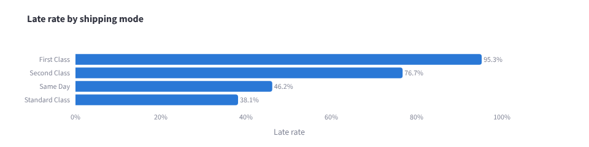
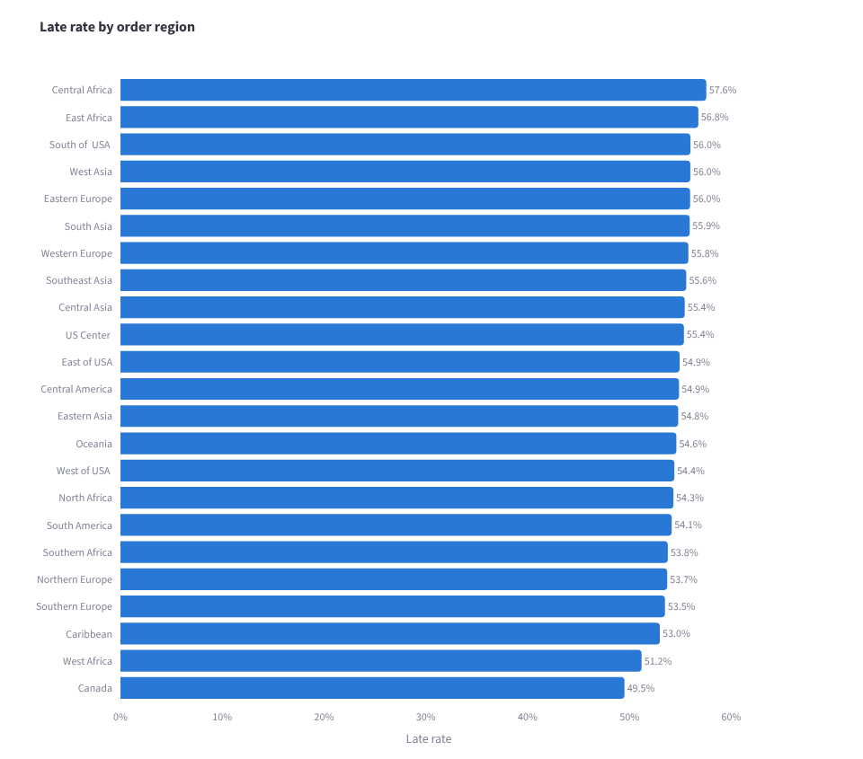
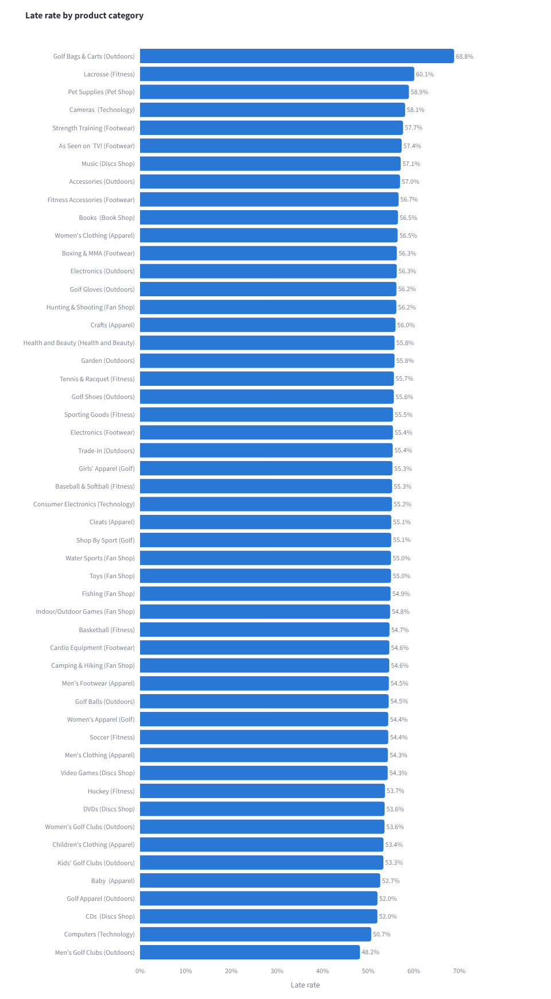

# Supply Chain Late-Delivery Risk Analytics


## Problem

Late deliveries cost money and customer trust. This project asks three questions
about the DataCo supply chain data:

1. **What is happening?** How often are orders late, and where (shipping mode,
   region, product category, month)?
2. **What drives it?** Which factors are statistically linked to late delivery
   (chi-square tests and a logistic regression)?
3. **Can we predict it?** Can a model flag high-risk orders using only
   information known when the order is placed?

Results are shown in a Streamlit dashboard.

## Data

[DataCo Smart Supply Chain for Big Data Analysis](https://www.kaggle.com/datasets/shashwatwork/dataco-smart-supply-chain-for-big-data-analysis)
(Kaggle). About 180k order lines across about 65k orders.

Download `DataCoSupplyChainDataset.csv` and place it in `data/raw/`. The `data/`
folder is git-ignored, so no data is committed.

## Approach

- **Database:** the CSV is cleaned (snake_case columns, PII dropped) and split into
  four DuckDB tables: `orders`, `order_items`, `customers` and `products`.
- **Analysis:** SQL queries with joins give late rates by shipping mode,
  market/region, product category and month.
- **Statistics:** chi-square tests (late vs. shipping mode, late vs. region) with
  Cramér's V as effect size, plus a statsmodels logistic regression reported as
  odds ratios.
- **Modeling:** one row per order. A logistic regression baseline and an XGBoost
  classifier, trained on a stratified 80/20 split with a fixed seed.
- **No target leakage:** anything known only after delivery is excluded from the
  features: real shipping days, delivery status, shipping date and order status.
  A check in `src/features.py` fails if any of them gets in.

## Project structure

```
src/config.py        paths and constants
src/build_db.py      CSV -> cleaned DuckDB tables
src/queries.py       SQL for late rates by mode, region, category, month
src/stats_tests.py   chi-square tests and logistic regression
src/features.py      order-level features, leakage check
src/train.py         train and save both models
src/evaluate.py      metrics CSV and scored test orders
app/dashboard.py     Streamlit dashboard
tests/test_data.py   data-quality tests on a small sample CSV
```

## How to run

Requires Python 3.12 or newer.

```bash
python -m venv .venv
source .venv/bin/activate          # Windows: .venv\Scripts\activate
pip install -r requirements.txt

python -m src.build_db             # build data/supply_chain.duckdb
python -m src.queries              # print late-rate breakdowns
python -m src.stats_tests          # print chi-square and regression results
python -m src.train                # train and save models
python -m src.evaluate             # print metrics, save reports/model_metrics.csv

python -m streamlit run app/dashboard.py
python -m pytest -v                # run tests
```

Run commands from the repo root with `python -m` so imports from `src` work.

On macOS, XGBoost needs the OpenMP runtime: `brew install libomp`.

## Key findings

All numbers below come from running the pipeline on the full dataset.

### Overview

- **65,752 orders** (180,519 order lines), January 2015 to January 2018.
- **54.82% of orders were late** (36,048 orders); 40.83% were on time or early.
  The rest were mostly canceled.
- Average shipping time was **3.50 days actual vs. 2.93 days scheduled**.

### Shipping mode is the main driver

| Shipping mode | Orders | Late rate | Scheduled days | Actual days (avg) |
|---|---:|---:|---:|---:|
| First Class | 10,079 | 95.27% | 1 | 2.00 |
| Second Class | 12,778 | 76.72% | 2 | 4.00 |
| Same Day | 3,571 | 46.15% | 0 | 0.48 |
| Standard Class | 39,324 | 38.13% | 4 | 4.00 |

The faster, premium modes promise more than they deliver: First Class is
scheduled for 1 day but takes 2 on average, so it is almost always late.



### Statistical tests

| Test (late vs. variable) | χ² | df | p-value | Cramér's V |
|---|---:|---:|---:|---:|
| Shipping mode | 13,661.67 | 3 | < 0.001 | 0.456 |
| Order region | 31.55 | 22 | 0.085 | 0.022 |

Shipping mode has a strong association with late delivery. Region is **not**
significant at the 5% level, and its effect size is negligible.

Logistic regression on order-time variables (n = 65,752, pseudo R² = 0.179),
reported as odds ratios vs. Standard Class / Cash payment:

| Variable | Odds ratio | 95% CI | p-value |
|---|---:|---:|---:|
| First Class | 33.61 | 30.59 – 36.94 | < 0.0001 |
| Second Class | 5.43 | 5.18 – 5.68 | < 0.0001 |
| Same Day | 1.40 | 1.31 – 1.50 | < 0.0001 |
| Payment: Transfer | 0.65 | 0.61 – 0.69 | < 0.0001 |

Market and customer segment had no significant effect (all p > 0.5).

### Region, category and month

- Late rates by region range only from 49.51% (Canada) to 57.55% (Central Africa).
- The large product categories all sit between about 54% and 55%. The extremes
  are small categories, e.g. Golf Bags & Carts at 68.85% from only 61 orders.
- Monthly late rates stay between 52.45% and 57.28% with no trend.



<details>
<summary>Late rate by product category</summary>



</details>

### Predicting late delivery

Features are limited to what is known when the order is placed (no real shipping
days, delivery status, shipping date or order status). Evaluated on 13,151
held-out orders (stratified 80/20 split):

| Model | ROC-AUC | Precision | Recall | F1 |
|---|---:|---:|---:|---:|
| Logistic regression | 0.7392 | 0.8456 | 0.5635 | 0.6763 |
| XGBoost | **0.7618** | 0.8166 | 0.6060 | 0.6957 |

- XGBoost confusion matrix: 4,369 late orders caught, 2,841 missed,
  981 on-time orders wrongly flagged, 4,960 correctly cleared.
- XGBoost improves ROC-AUC by 0.023 over the baseline. Most of the signal is
  shipping mode, which a linear model already captures.
- All 50 highest-risk test orders were First Class, and all 50 were actually late.

Full metrics: [`reports/model_metrics.csv`](reports/model_metrics.csv).

### Takeaway

Late delivery in this data is mostly a promise problem, not a geography or product
problem. First and Second Class are scheduled faster than they actually ship. Fixing
their scheduled delivery times (or their actual handling times) would cut late
deliveries far more than any regional or category-level change.
